# OrkaPlayer

A media player for Windows that plays pretty much anything, because the VLC engine sits inside it. No codec packs, no ads, nothing to sign up for. It has a classic, no-nonsense look, and it sings along: song lyrics scroll in time with the music, they can fill the whole screen in karaoke mode, and since 2.4 it plays podcasts and finds TV channels too.

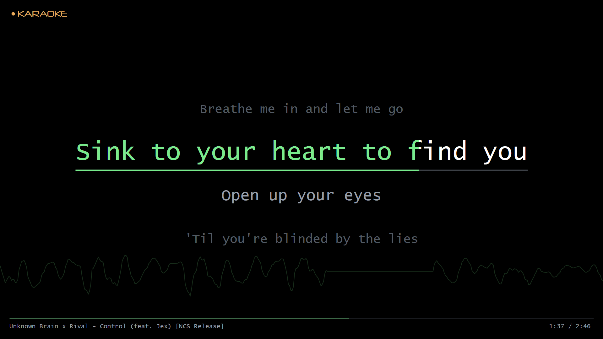

**[Download the latest version](https://github.com/cyz-yt/OrkaPlayer/releases/latest)** · [Website](https://cyzs-retroweb.rf.gd/orkaplayer.php)

Current version: **2.4 "Espresso"**

## What it does

**Playing**
- Audio and video in practically every format VLC handles, plus subtitles, audio track choice and snapshots from videos.
- Playback speed from 0.5x to 2x, a ten-band equalizer with VLC's eighteen presets and room for your own.
- Crossfade between songs, from 2 to 12 seconds, or no gap at all for live albums and mixes.
- A-B loop: mark a start and an end, and that part plays over and over.
- A sleep timer that fades the music out instead of cutting it off.
- Audio CDs straight from the drive, with CD-Text titles when the disc has them. A whole disc rips to a folder in one go.
- Discs full of MP3s play like a folder and their files copy to your computer. Home-made DVD films play too.
- Edit the tags of a song: title, artist, album, year, track number, genre and a cover picture.

**Radio, TV and podcasts**
- Internet radio: your own list of stations, plus a search through tens of thousands of stations on [radio-browser.info](https://www.radio-browser.info) by name, genre or country.
- TV channels: search free channels by name, country or category ([iptv-org](https://github.com/iptv-org/iptv)), or open any stream link - including channels from a satellite or cable box. Channel lists (`.m3u`) keep their names, and teletext is there when the channel carries it.
- Podcasts: paste a podcast's RSS link and play its episodes.

**Lyrics**
- Lyrics are found by themselves, scroll with the song and turn green as they are sung.
- Karaoke mode (F11) puts them on the whole screen.
- A song nobody has lyrics for? Sync your own: paste the words, play the song and tap Space at each line.
- A `.lrc` file next to the track always wins, then lyrics stored inside the file. Otherwise OrkaPlayer looks the song up on [LRCLIB](https://lrclib.net) and keeps what it found, so it never asks twice.

**Looking at it**
- An oscilloscope, a spectrum, level meters or the cover art while music plays - one click switches between them. The oscilloscope works on internet radio too.
- A mini player (Ctrl+M): a small strip that stays on top, with the current line of the lyrics.
- Playlists in tabs, with search, sorting, duplicate removal, drag to reorder and a queue (Play Next / Add to Queue). Files you open and discs get their own tabs.

**Around it**
- Save the sound of a video in its original quality, without re-encoding (.m4a, .mp3, .ogg, or WAV).
- Global media keys and buttons on the taskbar thumbnail.
- Discord Rich Presence, with an option to hide the track title.
- Only one copy runs at a time, so it can be driven from the command line (see below).
- Portable mode: put an empty `portable.txt` next to `OrkaPlayer.exe` and the settings stay on the drive.
- Updates: OrkaPlayer can check for a new version, download the installer from this GitHub page and check its SHA-256 before running it.

## Screenshots

| | |
|---|---|
| 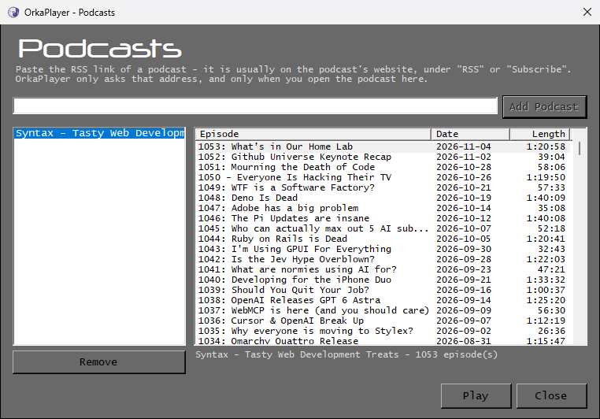 | 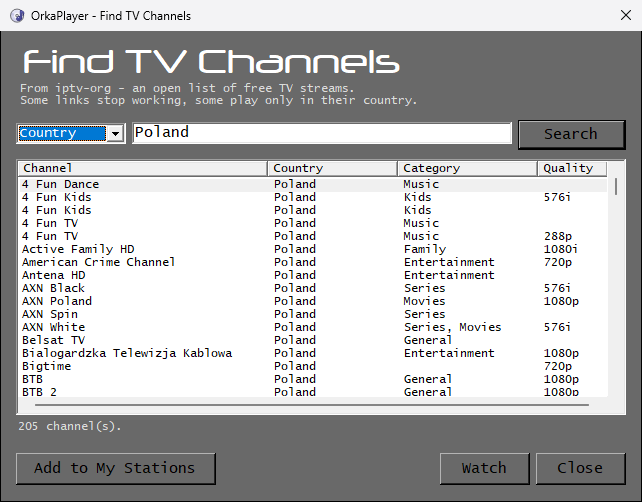 |
| Podcasts | Finding TV channels |
| 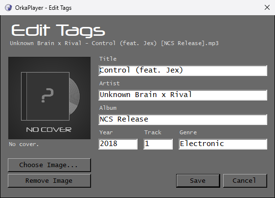 | 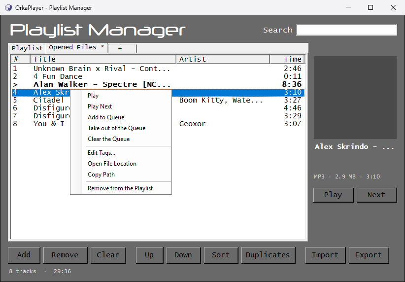 |
| Editing tags | Play Next, Add to Queue and Edit Tags right in the playlist |
| 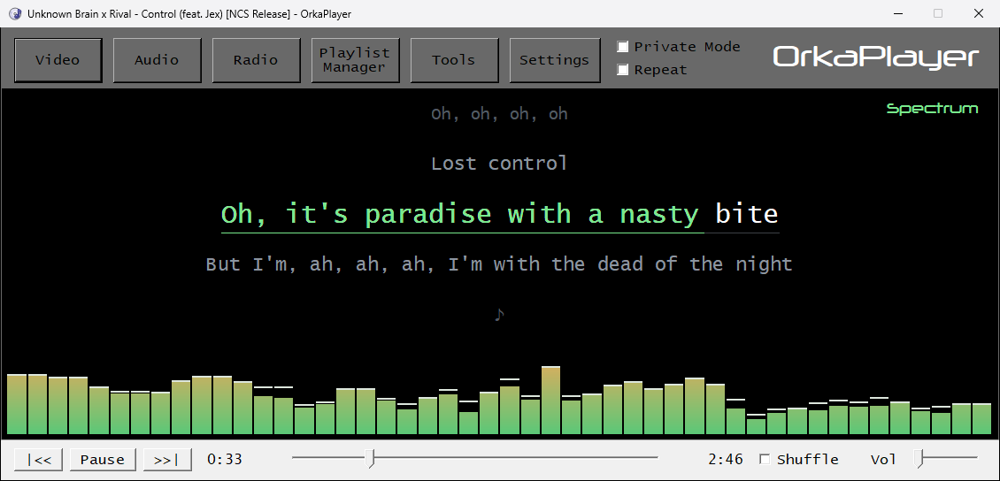 | 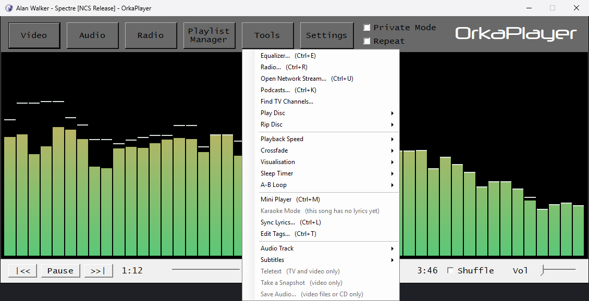 |
| One click switches the visualisation | The Tools menu in 2.4 |
| 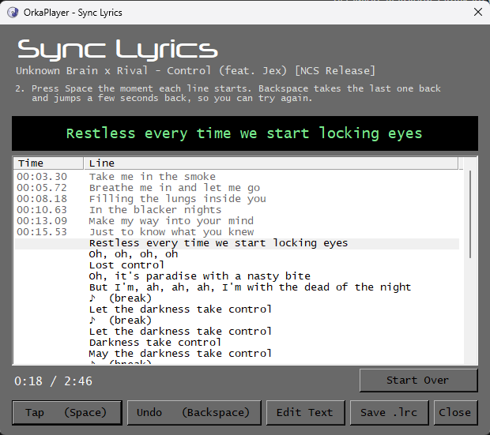 | 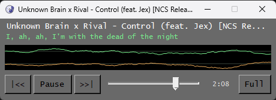 |
| Syncing your own lyrics | The mini player |
| 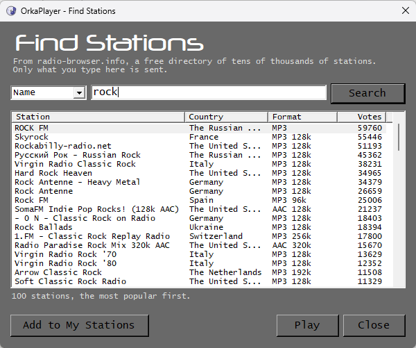 | 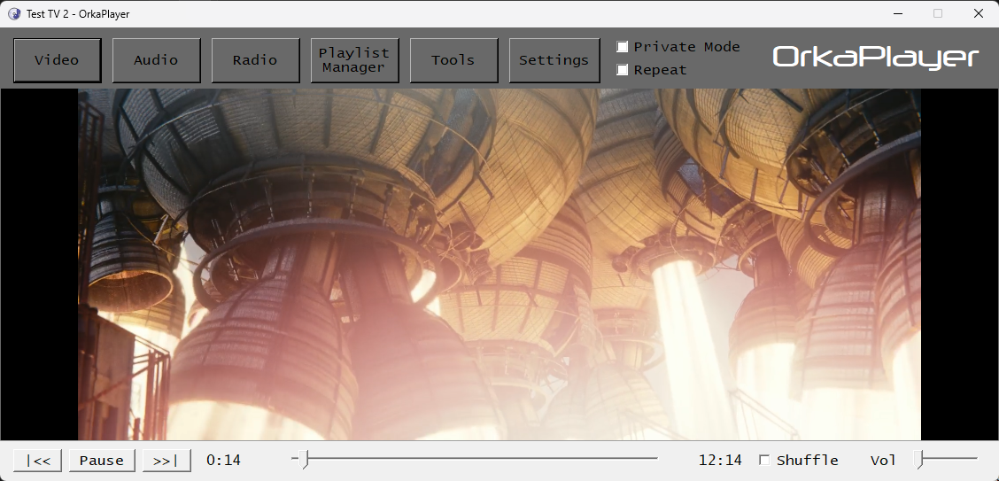 |
| Finding radio stations | TV from a link |
|  | 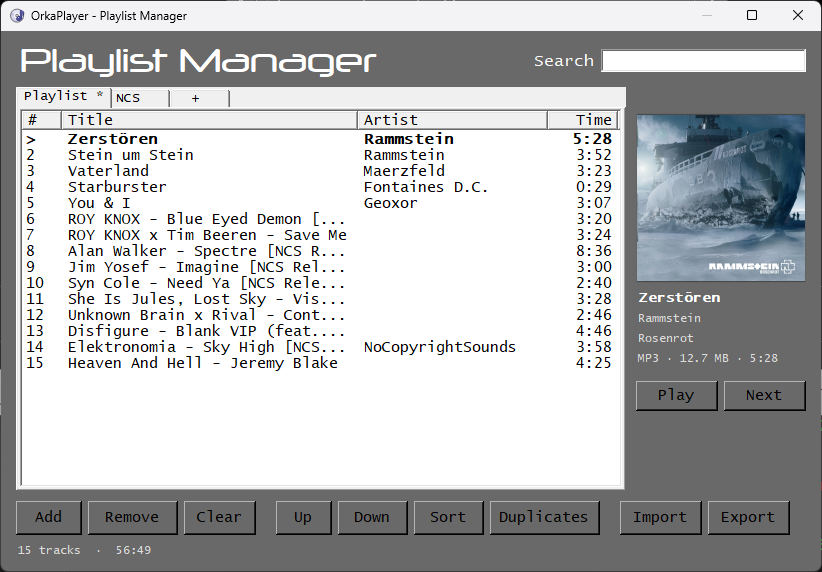 |
| Karaoke mode | Playlist Manager with the cover and track details |
| 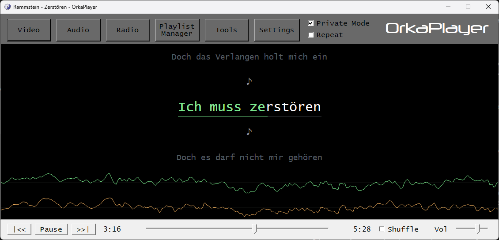 | 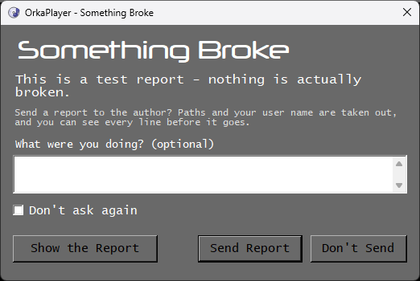 |
| Lyrics in the window | When something breaks, you see the whole report before it goes |

## Installing

1. Download `OrkaPlayer-2.4-setup.exe` from [Releases](https://github.com/cyz-yt/OrkaPlayer/releases/latest).
2. Run it. Windows may show "Windows protected your PC", because the installer is not code-signed. Click **More info**, then **Run anyway**.
3. **Express** installs everything. **Custom** lets you leave out parts you do not need: video playback (with subtitles and teletext), internet radio and streams, links to web pages, taskbar buttons, Discord, Save Audio and audio CDs. Leaving all of them out gives a lean player for music files.

**Requirements:** Windows 7 SP1 or newer, 64-bit, and .NET Framework 4.7.2 or newer. Windows 10 and 11 already have it. If it is missing, Setup says so and points to the download.

**Quiet install** (for scripts):

```
OrkaPlayer-2.4-setup.exe /SILENT /CURRENTUSER /assoc=no /updates=no
```

`/assoc=no` leaves file associations alone, `/updates=no` turns off the update check, and `/ALLUSERS` installs for everyone on the computer.

## Keyboard

| Key | What it does |
|---|---|
| Space | Play or pause |
| Left / Right | 5 seconds back or forward (with Ctrl: previous or next track) |
| Up / Down, M | Volume, mute |
| F11 | Karaoke mode |
| Ctrl+M | Mini player |
| Ctrl+L | Sync Lyrics |
| Ctrl+T | Edit the tags of the song that is playing |
| Ctrl+K | Podcasts |
| Ctrl+E | Equalizer |
| Ctrl+R | Radio |
| Ctrl+U | Open a network stream |
| F, Esc | Full screen for videos, and back |

## Command line

```
OrkaPlayer.exe [switches] [files or folders]

  --play            start playing
  --pause           pause
  --playpause       play or pause, whichever applies
  --stop            stop playback
  --next            next track
  --prev            previous track
  --volume=N        set the volume, 0 to 100
  --seek=N          jump to second N of the current track
  --show            bring the window to the front
  --quit            close the running OrkaPlayer
  --help            show all switches
```

Starting OrkaPlayer again hands the switches and the files to the window that is already open. Files opened this way go to the "Opened Files" playlist.

## What goes online

Nothing goes online without a reason, and each of these can be turned off in Settings:

- **Lyrics:** the artist, title, album and length of the track go to lrclib.net. *Settings > Library*
- **Station search:** only what you type in Find Stations goes to radio-browser.info. *Settings > Online*
- **TV channel search:** the channel list is downloaded from iptv-org (github.io) at most once a day, and the search runs on your computer. *Settings > Online, the same switch as the station search*
- **Podcasts:** only the RSS link you add is asked, and only when you open that podcast.
- **Update check:** at most once a day, OrkaPlayer reads a small version file from the website. Nothing is downloaded until you say so. *Settings > Online*
- **Problem reports:** sent only when you click **Send Report**. Paths and your Windows user name are removed, and you can read every line first. *Settings > Online*
- **Discord:** talks only to the Discord app on your own computer. *Settings > Online*

## Changes in 2.4 "Espresso"

- Podcasts (Ctrl+K): paste a podcast's RSS link and play its episodes.
- Find TV Channels: search free TV channels by name, country or category and watch them right away.
- Edit tags: title, artist, album, year, track number, genre and a cover picture.
- Lyrics stored inside MP3, FLAC and M4A files are read, synced ones first.
- No gap between songs (gapless).
- Discs full of MP3s play like a folder, Rip Disc copies their files, and home-made DVD films play.
- Files opened with Audio or Video and discs get their own playlists instead of landing in yours.
- Play Next really plays next, Add to Queue puts a song at the end, and >>| says what comes next.
- One click on the oscilloscope switches the visualisation. Volume goes up to 150%.
- Safer updates: only from this GitHub page, only over https, only with a matching checksum.
- Fixed: the oscilloscope on internet radio no longer freezes every few seconds.

## Changes in 2.3 "Doppio"

- Karaoke mode: press F11 and the lyrics fill the whole screen.
- Sync your own lyrics: paste the words, play the song and tap Space at each line. Saved as a `.lrc` next to the song.
- Mini player (Ctrl+M) that stays on top, with the current line of the lyrics.
- Crossfade between songs, off by default.
- TV from a link: streams with a picture show it, channel lists keep their names, and teletext is in Tools.
- Find Stations in Radio: search radio-browser.info by name, genre or country.
- Rip a whole audio CD to a folder in one go.
- More parts of Setup can be left out: subtitles, teletext, radio and streams, links to web pages.
- Fixed: lyrics that were found no longer vanish when the tags load, `.m3u` channel lists no longer load empty, and a `cover.jpg` in Music or Downloads no longer becomes the cover of every loose song.

Older versions are on the [Releases](https://github.com/cyz-yt/OrkaPlayer/releases) page.

## Built with

- VB.NET and Windows Forms on .NET Framework 4.7.2
- [LibVLCSharp](https://github.com/videolan/libvlcsharp) 3.10.1 and libVLC 3.0.23 from [VideoLAN](https://www.videolan.org/) (LGPL 2.1)
- [Newtonsoft.Json](https://www.newtonsoft.com/json), [DiscordRichPresence](https://github.com/Lachee/discord-rpc-csharp), Windows API Code Pack
- Lyrics from [LRCLIB](https://lrclib.net), radio stations from [radio-browser.info](https://www.radio-browser.info), TV channels from [iptv-org](https://github.com/iptv-org/iptv)

## More from the same author

- [OrkaNote](https://github.com/cyz-yt/OrkaNote): a Notepad for Windows with tabs that come back, colours for code, Run (F9) for scripts and a dark theme.
- [OrkaLinux](https://github.com/cyz-yt/OrkaLinux): a Linux distribution built on Debian 13 with KDE Plasma 6.
