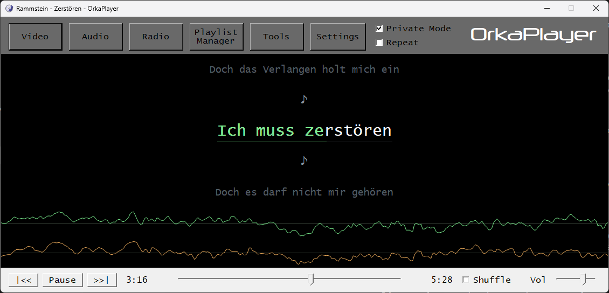
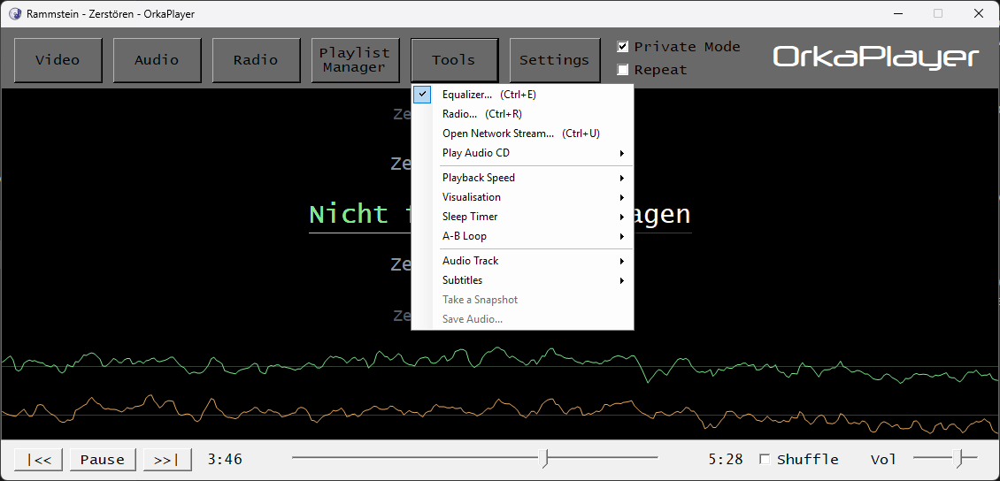
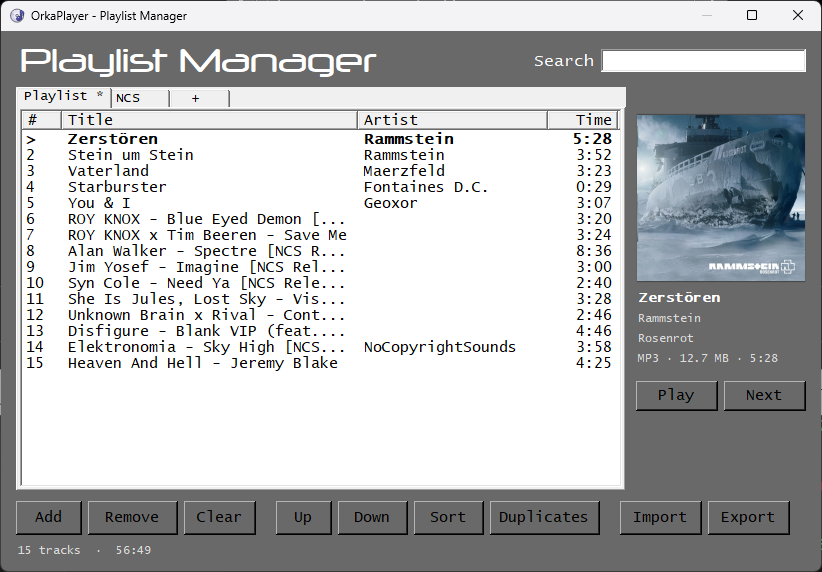
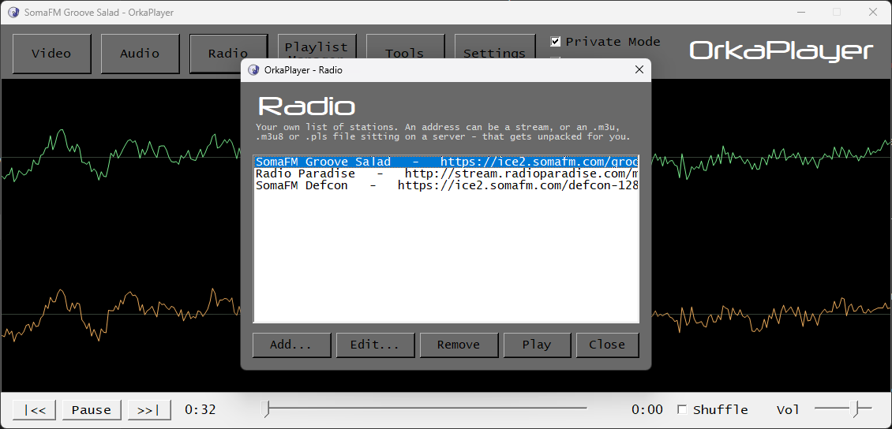
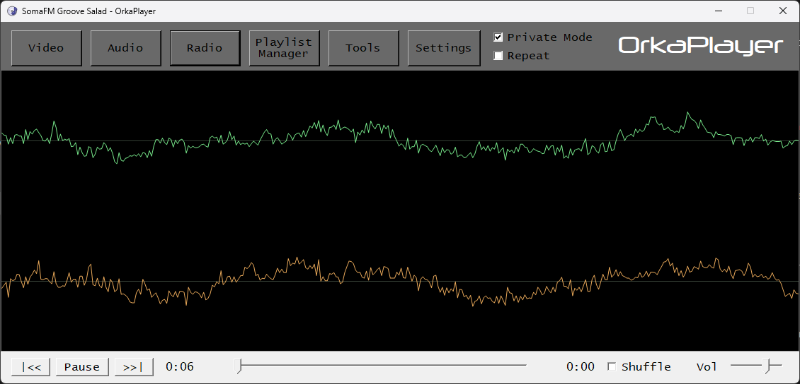
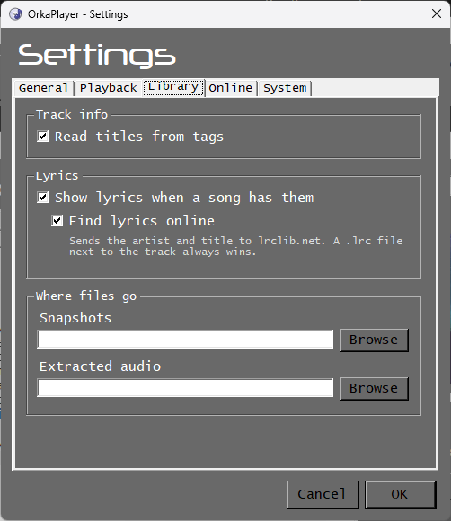
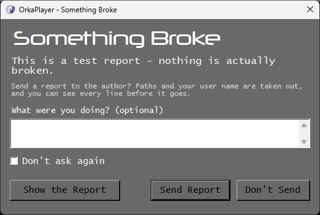

# OrkaPlayer

A media player for Windows that plays pretty much anything, because the VLC engine sits inside it. No codec packs, no ads, nothing to sign up for. It has a classic, no-nonsense look, and since 2.2 it sings along: song lyrics scroll in time with the music, karaoke style.



**[Download the latest version](https://github.com/cyz-yt/OrkaPlayer/releases/latest)** · [Website](https://cyzs-retroweb.rf.gd/orkaplayer.php)

Current version: **2.2 "Cortado"**

## What it does

**Playing**
- Audio and video in practically every format VLC handles, plus subtitles, audio track choice and snapshots from videos.
- Playback speed from 0.5x to 2x, a ten-band equalizer with VLC's eighteen presets and room for your own.
- A-B loop: mark a start and an end, and that part plays over and over.
- A sleep timer that fades the music out instead of cutting it off.
- Audio CDs straight from the drive, with CD-Text titles when the disc has them.
- Internet radio: your own list of stations. A stream address works, and so does an .m3u, .m3u8 or .pls file.

**Lyrics**
- Lyrics are found by themselves, scroll with the song and turn green as they are sung.
- A `.lrc` file next to the track always wins. Otherwise OrkaPlayer looks the song up on [LRCLIB](https://lrclib.net) and keeps what it found, so it never asks twice.

**Looking at it**
- An oscilloscope, a spectrum, level meters or the cover art while music plays. The oscilloscope works on internet radio too.
- Playlists in tabs, with search, sorting, duplicate removal, drag to reorder and a "play next" queue.

**Around it**
- Save the sound of a video in its original quality, without re-encoding (.m4a, .mp3, .ogg, or WAV). Tracks from an audio CD save as WAV.
- Global media keys and buttons on the taskbar thumbnail.
- Discord Rich Presence, with an option to hide the track title.
- Only one copy runs at a time, so it can be driven from the command line (see below).
- Portable mode: put an empty `portable.txt` next to `OrkaPlayer.exe` and the settings stay on the drive.
- Updates: OrkaPlayer can check for a new version, download the installer and check its SHA-256 before running it.

## Screenshots

| | |
|---|---|
|  |  |
| The Tools menu | Playlist Manager with the cover and track details |
|  |  |
| The list of radio stations | The oscilloscope on internet radio |
|  |  |
| Settings, split into tabs | When something breaks, you see the whole report before it goes |

## Installing

1. Download `OrkaPlayer-2.2-setup.exe` from [Releases](https://github.com/cyz-yt/OrkaPlayer/releases/latest).
2. Run it. Windows may show "Windows protected your PC", because the installer is not code-signed. Click **More info**, then **Run anyway**.
3. **Express** installs everything. **Custom** lets you leave out parts you do not need: video playback, taskbar buttons, Discord, Save Audio and audio CDs. Leaving all of them out gives a lean audio-only player.

**Requirements:** Windows 7 SP1 or newer, 64-bit, and .NET Framework 4.7.2 or newer. Windows 10 and 11 already have it. If it is missing, Setup says so and points to the download.

**Quiet install** (for scripts):

```
OrkaPlayer-2.2-setup.exe --fast
OrkaPlayer-2.2-setup.exe /SILENT /CURRENTUSER /assoc=no /updates=no
```

`--fast` installs with just a progress bar. `/assoc=no` leaves file associations alone, `/updates=no` turns off the update check, and `/ALLUSERS` installs for everyone on the computer.

## Command line

```
OrkaPlayer.exe [switches] [files or folders]

  --play            start playing
  --pause           pause
  --playpause       play or pause, whichever applies
  --stop            stop playback
  --next            next track
  --prev            previous track
  --volume=N        set the volume, 0 to 100
  --seek=N          jump to second N of the current track
  --show            bring the window to the front
  --quit            close the running OrkaPlayer
  --help            show all switches
```

Starting OrkaPlayer again hands the switches and the files to the window that is already open. Files opened this way join the playlist that is playing.

## What goes online

Nothing goes online without a reason, and each of these can be turned off in Settings:

- **Lyrics:** the artist, title, album and length of the track go to lrclib.net. *Settings > Library*
- **Update check:** at most once a day, OrkaPlayer reads a small version file from the website. Nothing is downloaded until you say so. *Settings > Online*
- **Problem reports:** sent only when you click **Send Report**. Paths and your Windows user name are removed, and you can read every line first. *Settings > Online*
- **Discord:** talks only to the Discord app on your own computer. *Settings > Online*

## Changes in 2.2 "Cortado"

- Lyrics scroll in time with the song, karaoke style. They are found online by themselves, or read from a .lrc file next to the track.
- A-B loop: play one part over and over.
- The sleep timer fades the music out instead of cutting it off.
- Audio CDs play from Tools, and their tracks save as WAV.
- Save the sound of a video in its original quality, without re-encoding.
- The oscilloscope works on internet radio too.
- After a crash, OrkaPlayer offers to send a report, and you see every line first.
- Tidier Settings and Playlist Manager, and a Radio button where Stop used to be.
- Fixed a freeze that could happen right as a track started.
- Picking an output device in Settings finally works.
- No internet? OrkaPlayer now says so plainly instead of showing a network error.
- Opening a file adds it to the playlist instead of replacing the whole list.

Older versions are on the [Releases](https://github.com/cyz-yt/OrkaPlayer/releases) page.

## Built with

- VB.NET and Windows Forms on .NET Framework 4.7.2
- [LibVLCSharp](https://github.com/videolan/libvlcsharp) 3.10.1 and libVLC 3.0.23 from [VideoLAN](https://www.videolan.org/) (LGPL 2.1)
- [Newtonsoft.Json](https://www.newtonsoft.com/json), [DiscordRichPresence](https://github.com/Lachee/discord-rpc-csharp), Windows API Code Pack
- Lyrics from [LRCLIB](https://lrclib.net)

## More from the same author

- [OrkaNote](https://cyzs-retroweb.rf.gd/orkanote.php): a Notepad for Windows, lighter than the built-in one.
- [OrkaLinux](https://cyzs-retroweb.rf.gd/orkalinux.php): a Linux distribution built on Debian 12 with KDE Plasma.
